 

<i>"Dari ide, jadi sesuatu yang bisa dipegang dan dipakai."</i>

## 👋 Tentang aku

Mahasiswa D4 Teknik Mekatronika di Politeknik Negeri Batam. Aku belajar menjembatani perangkat keras dan perangkat lunak, supaya sebuah ide bisa benar-benar dipakai orang.

## ✨ Yang aku minati

<table width="100%">
  <tr>
    <td align="center" width="33%">
      <h3>⚙️</h3>
      <b>Desain mekanik</b> 
      Gambar teknik &amp; CAD
    </td>
    <td align="center" width="33%">
      <h3>🔌</h3>
      <b>Embedded &amp; AIoT</b> 
      Mikrokontroler dan perangkat pintar
    </td>
    <td align="center" width="33%">
      <h3>📱</h3>
      <b>Aplikasi mobile</b> 
      Flutter
    </td>
  </tr>
</table>

## 🛠️ Tools

<!-- GANTI: tambah atau hapus icon sesuai yang benar-benar kamu pakai. Daftar icon: https://skillicons.dev -->

  

## 📬 Kontak

  
  

